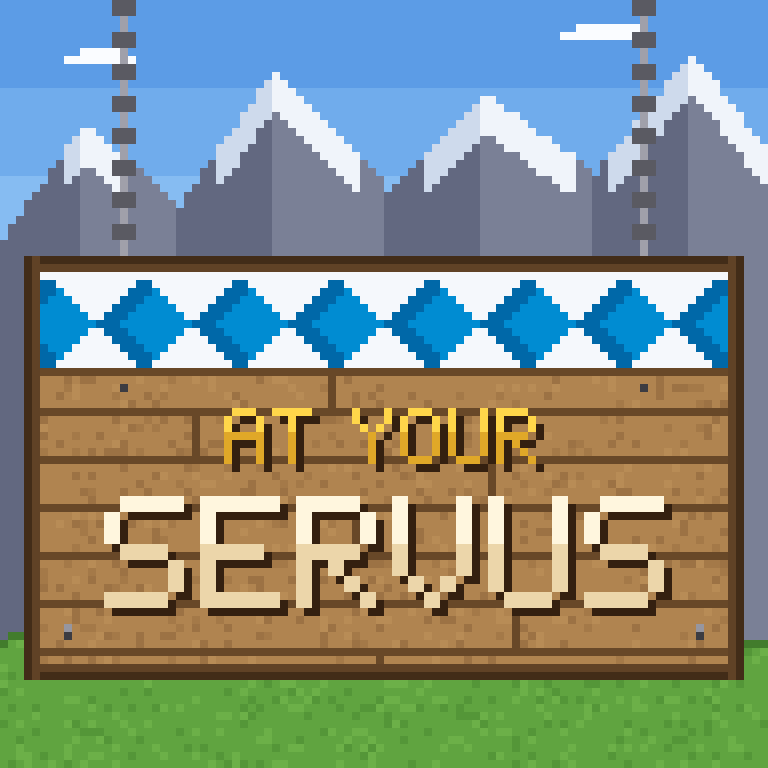

<p align="center"></p>

<p align="center">
  <a href="https://www.curseforge.com/minecraft/modpacks/at-your-servus/files/all"></a>
  <a href="https://www.curseforge.com/minecraft/modpacks/at-your-servus"></a>
  <a href="https://www.curseforge.com/minecraft/modpacks/at-your-servus"></a>
  <a href="https://github.com/Dirnei/at_your_servus/actions/workflows/build.yml"></a>
  <a href="CHANGELOG.md"></a>
</p>

# At Your Servus

A story-driven kitchen sink modpack for Minecraft 26.1.2 on NeoForge, built around the Servus mods: Foundation, Alchemy and Shuttles. Rebuild Uncle Vinzenz's lost farm above Berchtesgaden, guided by his letters in FTB Quests.

## Play

Install it from CurseForge, or build it and import `dist/at-your-servus-<version>.zip` in the CurseForge app (Create Custom Profile, Import). Give the game at least 6 GB of RAM.

## Build

```powershell
.\tools\build.ps1        # client zip and server pack in dist/
docker compose up -d     # local test server on localhost:25567
```

Needs packwiz, Java, Python and PowerShell; details in [`docs/development.md`](docs/development.md).

## More

- [`docs/mods.md`](docs/mods.md): every mod and why it is in the pack
- [`docs/story.md`](docs/story.md): the story behind the quests
- [`docs/gates.md`](docs/gates.md): recipe changes
